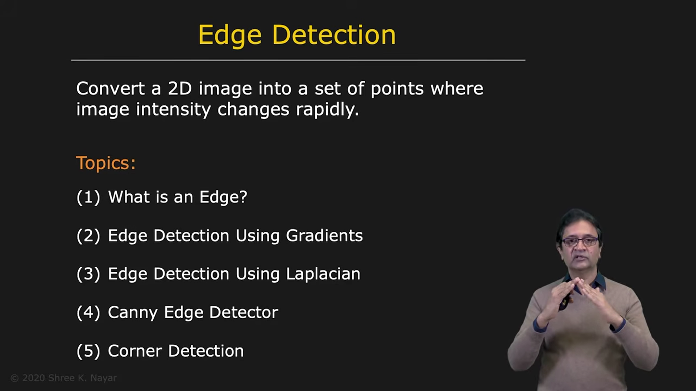

# Edge Detection: Overview

Edges are important in computer vision because they mark locations where image intensity changes rapidly. From an information-theory perspective, these changes often carry much of the useful visual structure in an image.

In this lecture, we develop techniques for converting a two-dimensional image into a set of points that indicate likely edges.

---

## 1. What Is an Edge?

An edge is a location in an image where intensity changes rapidly over a small spatial distance.

We begin by studying:

* what edges are
* which physical phenomena in a scene create image edges
* which edge properties an algorithm should estimate
* how to evaluate the performance of an edge detector

---

## 2. A Theoretical Framework for Edge Detection

To build an edge detector, we first establish a mathematical model for an edge and consider the effects of noise and image sampling.

A useful starting point is to examine how image intensity changes across an edge. Derivatives measure these changes and provide the foundation for several edge-detection methods.

---

## 3. First-Derivative Edge Detection: The Gradient

The first derivative of an image measures how quickly its intensity changes. In two dimensions, the derivatives form the image gradient:

$$
\nabla f(x,y)=
\begin{bmatrix}
\frac{\partial f}{\partial x}\\[4pt]
\frac{\partial f}{\partial y}
\end{bmatrix}
$$

The gradient can be implemented using convolution with derivative filters.

Its magnitude indicates the strength of the intensity change, while its direction indicates the direction in which intensity increases most rapidly. The edge itself lies approximately perpendicular to this direction.

---

## 4. Second-Derivative Edge Detection: The Laplacian

The second derivative can also be used to detect edges. In two dimensions, the Laplacian operator is:

$$
\nabla^2 f(x,y)=
\frac{\partial^2 f}{\partial x^2}
+
\frac{\partial^2 f}{\partial y^2}
$$

The gradient and Laplacian operators each have advantages and limitations. Their behavior motivates the design of more robust edge detectors.

---

## 5. The Canny Edge Detector

The Canny edge detector combines useful ideas from first- and second-derivative approaches to produce reliable edge maps. It is widely used in computer vision.

The detector is designed to find meaningful edges while balancing detection quality, accurate localization, and resilience to noise.

---

## 6. Corner Detection

A corner is a location where two edges meet at an angle. The goal of corner detection is to find the corner's location precisely, without requiring prior knowledge of the brightness on either side of the corner or the angle at which the edges meet.

We will study the Harris corner detector, a reliable method for locating corners.

---

## 7. Summary

This lecture introduces the main ideas and methods used to find edges and corners in images:

* edges are rapid changes in image intensity
* physical scene changes create image edges
* an edge detector should estimate useful edge attributes and perform reliably
* the gradient uses first derivatives and can be implemented with convolution
* the Laplacian uses second derivatives
* the Canny detector combines effective ideas to produce robust edge detection
* the Harris detector finds corner locations where edges meet

These methods turn image intensity patterns into features that can support later computer-vision tasks.
