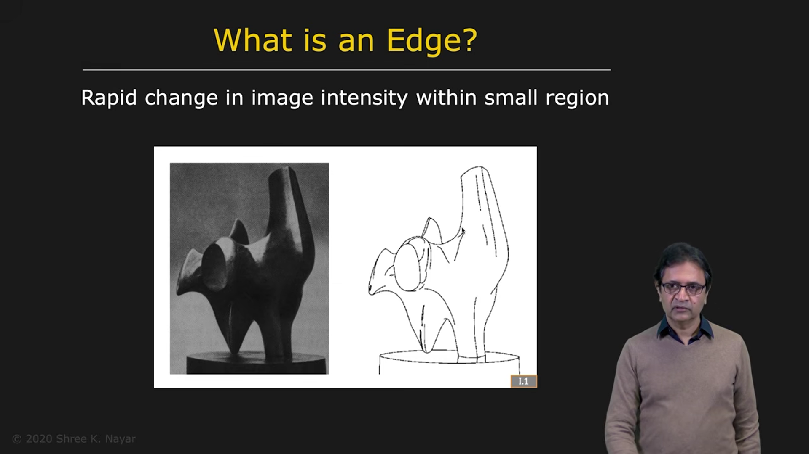
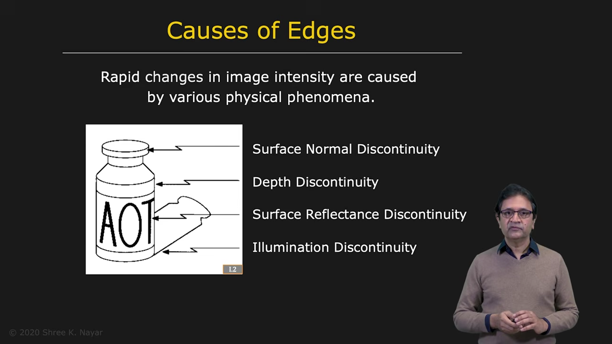
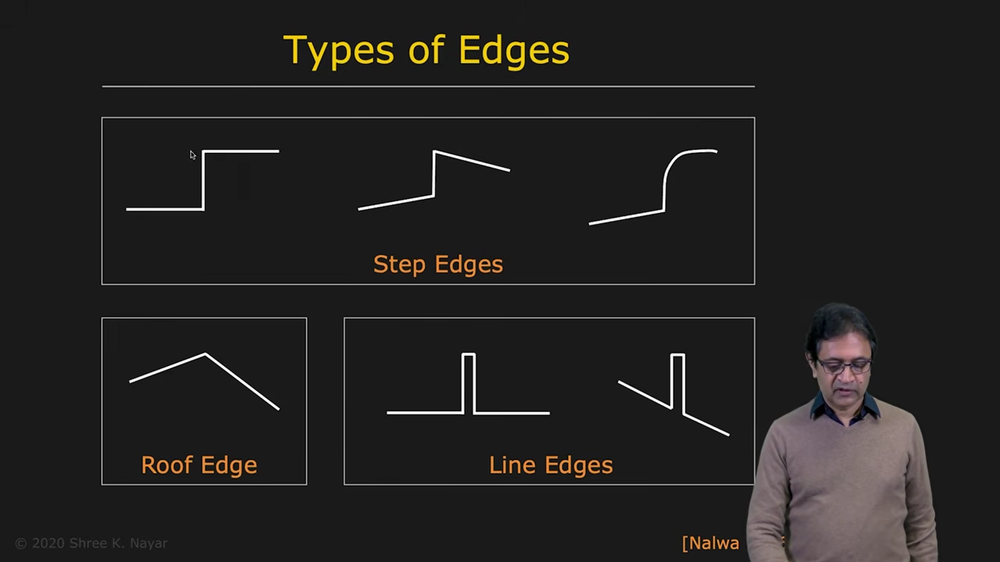
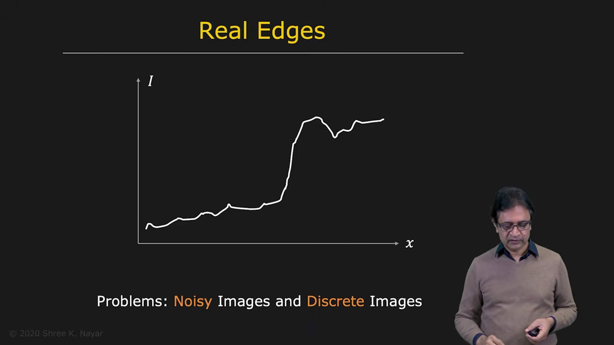
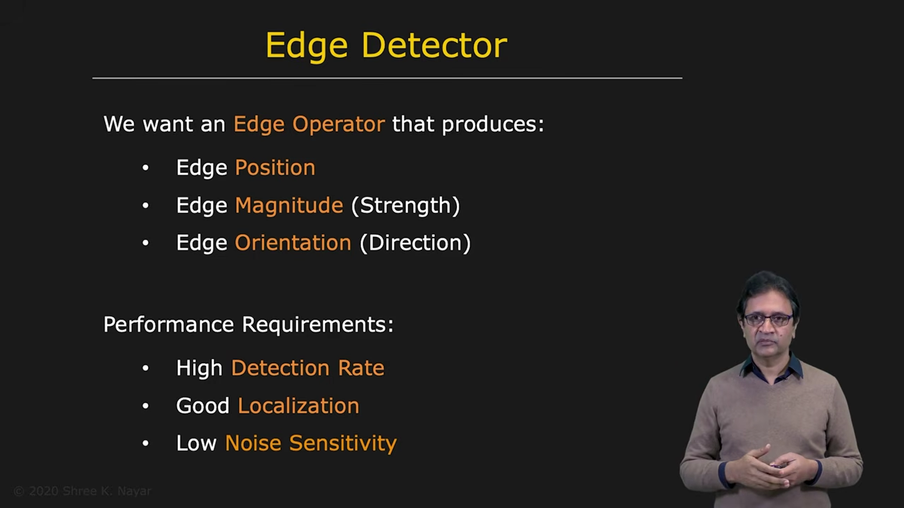

# What Is an Edge?

Loosely speaking, an edge is a rapid change in image intensity within a small region of an image.

Edges are important because a relatively small number of intensity changes can convey a great deal of visual information about object shape, three-dimensional structure, shading, and highlights.

---

## 1. Why Are Edges Important?

A photograph of a sculpture contains many pixel values. An artist may represent the same sculpture with only a few carefully chosen strokes.

Those strokes can still communicate much of the sculpture's three-dimensional structure, along with lighting effects such as shading and highlights. This illustrates how much visual information can be carried by edges and other rapid changes in brightness.

---

## 2. Physical Causes of Edges

Several different physical phenomena can produce edges in an image. Therefore, an image edge does not always correspond to an object boundary.

### 2.1 Depth Discontinuity

A depth discontinuity occurs where one object lies in front of another. The two objects may be made of different materials or receive different illumination, producing a sudden brightness change at their boundary.

For example, the outline of a bottle against its background may appear as an edge.

### 2.2 Surface-Normal Discontinuity

Two adjoining surfaces can have the same material but different orientations. Because their surface normals differ, they may receive different amounts of light and appear at different brightness levels.

The brightness change where the surfaces meet creates an edge.

### 2.3 Surface-Reflectance Discontinuity

A change in surface material or pigment changes reflectance. For example, dark letters printed on a bottle label have different reflectance from the label around them. This creates intensity edges even though the surface may be physically flat.

### 2.4 Illumination or Shadow Discontinuity

A sudden change in illumination also produces an edge. For example, a bottle may cast a sharp shadow on the background. The boundary between the illuminated and shadowed regions is an image edge, even though it may not mark a material boundary.

---

## 3. Edge Profiles

An edge can have different intensity profiles when we look across it in the image. Examples include:

* a step edge, where intensity changes abruptly from one level to another
* a step edge with a gradual transition on one or both sides
* a profile with linear change on one side and nonlinear change on the other
* a roof edge, where intensity rises and then falls

A line can be viewed as two nearby edges: a rising edge on one side and a falling edge on the other.

To develop a mathematical theory of edge detection, we need a model. We will use the simplest one: the **step edge**.

An ideal step edge would be clean and abrupt. Real image edges are often less regular because of noise, image sampling, quantization, and other imaging effects. An edge detector must still detect them reliably.

---

## 4. What Should an Edge Detector Find?

A useful edge detector should estimate several properties.

### Position

The detector should locate where the edge occurs. Depending on the application, the desired location may need sub-pixel accuracy—that is, an estimate of where the edge lies within a pixel, rather than only a pixel index.

### Magnitude

The edge magnitude describes the strength of the intensity change. It can be used with a threshold to decide whether an edge is significant for a particular application.

### Orientation

The edge orientation describes the direction of the edge in the image. This information can help distinguish boundaries with different directions.

---

## 5. Performance Criteria

A good edge detector should satisfy several criteria:

* **High detection rate:** detect an edge when one is present.
* **Low false-positive rate:** avoid reporting edges where none exist.
* **Low false-negative rate:** avoid missing real edges.
* **Accurate localization:** place detected edges close to their true positions.
* **Noise resilience:** continue to work reliably when the image contains noise.

These goals can compete. For example, responding strongly to weak intensity changes may find more real edges, but can also increase false positives from noise.

---

## 6. Summary

An edge is a rapid change in image intensity, but its physical cause can vary. Common causes include:

* depth discontinuities
* changes in surface orientation
* changes in surface reflectance
* illumination and shadow boundaries

Edges may have step, ramp, roof, or other intensity profiles. A step edge provides a useful starting model, even though real edges are affected by noise, sampling, and quantization.

An edge detector should estimate edge position, magnitude, and orientation while achieving reliable detection, accurate localization, and resilience to noise.
