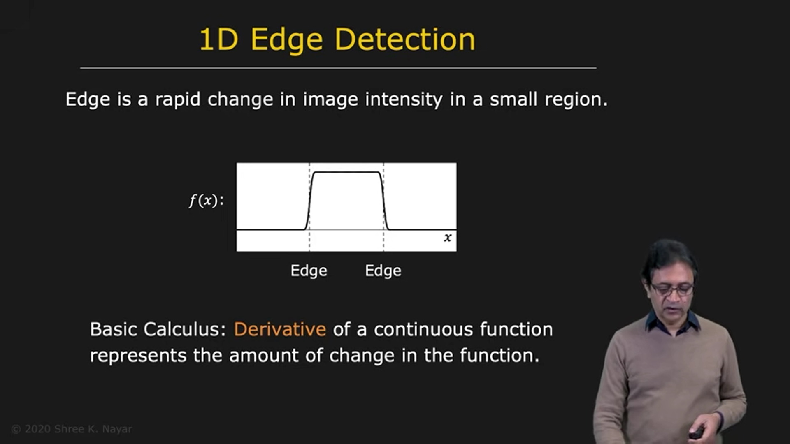
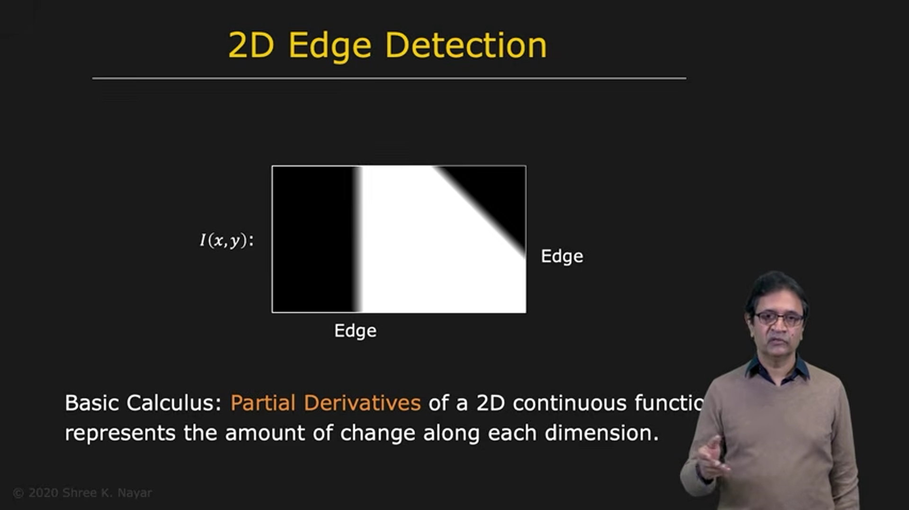
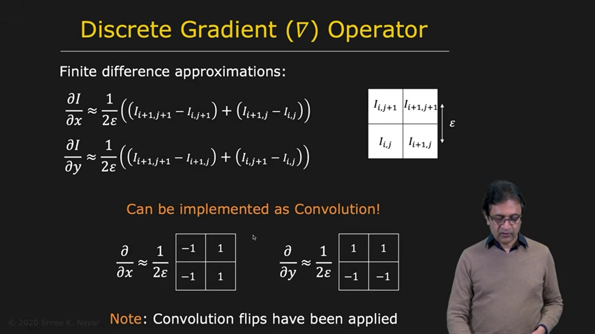
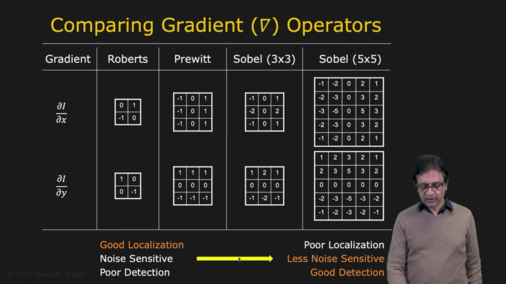
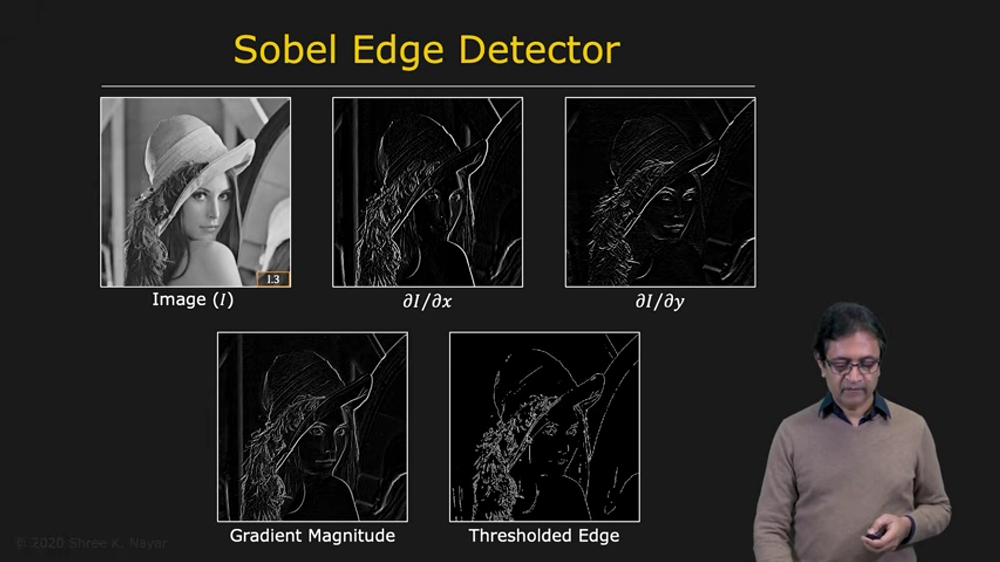

# Edge Detection Using the Gradient

The gradient operator is an edge detector based on the **first derivative** of an image. Since an edge is a rapid change in intensity, measuring how quickly intensity changes is a natural way to locate edges.

---

## 1. Detecting Edges in a One-Dimensional Signal

Consider a one-dimensional signal $f(x)$ containing a rising edge and a falling edge.

In regions where the signal is constant, its derivative is zero. Near an edge, the intensity changes rapidly, so the derivative has a large magnitude.

* A rising edge produces a positive derivative peak.
* A falling edge produces a negative derivative peak.

Thus, the locations of strong extrema in the first derivative indicate edge positions. The magnitude of each peak indicates how strong the edge is.

---

## 2. Extending the Gradient to Two Dimensions

A two-dimensional image has intensity $f(x,y)$. Its gradient is a vector containing the rate of change in both image directions:

$$
\nabla f(x,y)=
\begin{bmatrix}
\frac{\partial f}{\partial x}\\[4pt]
\frac{\partial f}{\partial y}
\end{bmatrix}
=
\begin{bmatrix}
f_x\\
f_y
\end{bmatrix}
$$

The components describe intensity change along the horizontal and vertical image axes.

Examples:

* For a vertical edge, intensity changes horizontally, so $f_x$ is nonzero and $f_y$ is approximately zero.
* For a horizontal edge, intensity changes vertically, so $f_y$ is nonzero and $f_x$ is approximately zero.
* For a tilted edge, intensity may change in both directions, so both components are nonzero.

---

## 3. Edge Magnitude and Direction

The gradient gives two useful quantities at each pixel.

### Gradient magnitude

The gradient magnitude measures the strength of the intensity change:

$$
M(x,y)=\|\nabla f(x,y)\|
=\sqrt{f_x^2+f_y^2}
$$

A large magnitude suggests a strong edge; a small magnitude suggests a flat or slowly varying region.

A faster approximation sometimes used in computation is:

$$
M(x,y)\approx |f_x|+|f_y|
$$

### Gradient direction

The gradient direction points in the direction of the fastest increase in intensity:

$$
\theta_g(x,y)=\operatorname{atan2}(f_y,f_x)
$$

The edge itself runs approximately perpendicular to the gradient direction. If edge orientation is measured relative to the horizontal axis, it can be written as:

$$
\theta_e=\theta_g+\frac{\pi}{2}\quad (\text{mod }\pi)
$$

Using $\operatorname{atan2}$ instead of a simple inverse tangent correctly handles all four direction quadrants.

---

## 4. Derivatives on a Discrete Image

A digital image contains samples rather than a continuous function. We therefore approximate derivatives using finite differences.

Let neighboring pixel centers be separated by a distance $\epsilon$. A central-difference approximation is:

$$
f_x(x,y)\approx
\frac{f(x+\epsilon,y)-f(x-\epsilon,y)}{2\epsilon}
$$

$$
f_y(x,y)\approx
\frac{f(x,y+\epsilon)-f(x,y-\epsilon)}{2\epsilon}
$$

These formulas estimate the horizontal and vertical derivatives by comparing pixels on opposite sides of the location being evaluated.

If the physical pixel spacing $\epsilon$ is unknown, the derivatives can still be used for edge detection. The unknown spacing scales the gradient values, so the magnitude threshold must be adjusted accordingly.

---

## 5. Implementing the Gradient with Convolution

Finite differences can be implemented as convolution with small masks. For a two-by-two neighborhood, one common pair of masks is:

$$
K_x=\frac{1}{2\epsilon}
\begin{bmatrix}
1 & -1\\
1 & -1
\end{bmatrix}
\qquad
K_y=\frac{1}{2\epsilon}
\begin{bmatrix}
1 & 1\\
-1 & -1
\end{bmatrix}
$$

The masks estimate intensity change in two perpendicular directions. (As usual, the displayed mask signs may depend on the convolution-versus-correlation convention.)

Convolving the image with $K_x$ gives one derivative estimate; convolving it with $K_y$ gives the other. The two results are then combined to calculate gradient magnitude and direction.

---

## 6. Common Gradient Operators

Several gradient operators use different mask sizes and weightings.

* **Roberts operator:** uses small masks and estimates derivatives along diagonal directions.
* **Prewitt operator:** uses $3\times3$ masks, averaging across neighboring rows or columns while estimating a derivative.
* **Sobel operator:** also uses $3\times3$ masks, with greater weight given to pixels near the center row or column.
* **Larger Sobel operators:** use a wider neighborhood and therefore include more smoothing.

The derivative directions in each pair of masks are orthogonal. These operators provide estimates of the two gradient components.

### The localization–noise trade-off

Small masks:

* use nearby pixels only
* localize an edge precisely
* are sensitive to noise because a small number of pixel values determine the result

Larger masks:

* average information over a wider neighborhood
* reduce the effect of noise
* may give poorer localization because pixels farther from the edge also influence the result

Many larger derivative masks can be understood as a small derivative operator combined with smoothing, often similar to Gaussian smoothing.

---

## 7. Applying a Sobel Gradient

Applying the two $3\times3$ Sobel masks to an image produces horizontal and vertical derivative images, $f_x$ and $f_y$.

The gradient magnitude is then calculated at each pixel:

$$
M=\sqrt{f_x^2+f_y^2}
$$

This magnitude image highlights locations where intensity changes strongly. However, it is not yet a binary edge map: a rule is still needed to decide which gradient magnitudes count as edges.

---

## 8. Thresholding the Gradient Magnitude

### Single-threshold method

Choose a threshold $T$ and classify pixels as:

$$
\text{edge}(x,y)=
\begin{cases}
1, & M(x,y)\geq T\\
0, & M(x,y)<T
\end{cases}
$$

A larger threshold keeps only stronger edges. A smaller threshold detects weaker edges but may also include more noise and false detections.

### Hysteresis thresholding

Hysteresis uses two thresholds, a low threshold $T_0$ and a high threshold $T_1$, with $T_0<T_1$:

* If $M<T_0$, classify the pixel as not an edge.
* If $M\geq T_1$, classify it as a strong edge.
* If $T_0\leq M<T_1$, keep it as an edge only if it is connected to a strong-edge pixel.

This uses neighborhood context to retain weak edge responses that continue a strong edge, while rejecting isolated weak responses. Hysteresis thresholding is also used in the Canny edge detector.

---

## 9. From an Edge Map to Object Boundaries

Thresholding a gradient magnitude produces an edge map: a set of edge pixels. These pixels may be scattered, broken, or disconnected.

People often group such points into continuous curves automatically, but a computer must perform this grouping explicitly. Turning an edge map into clean, connected object boundaries is a separate and challenging problem that requires additional processing.

---

## 10. Summary

The gradient edge detector uses first derivatives to find rapid intensity changes.

The main steps are:

1. Estimate the horizontal and vertical derivatives, $f_x$ and $f_y$.
2. Compute the gradient magnitude to measure edge strength.
3. Compute the gradient direction to describe the direction of intensity increase.
4. Threshold the magnitude to form an edge map.

The gradient magnitude and direction are:

$$
M=\sqrt{f_x^2+f_y^2},
\qquad
\theta_g=\operatorname{atan2}(f_y,f_x)
$$

Finite-difference masks implement the derivatives using convolution. Small masks provide better localization but are more sensitive to noise; larger masks provide more smoothing but can reduce localization accuracy. Hysteresis thresholding uses neighboring strong edges to make more reliable decisions about weak responses.
