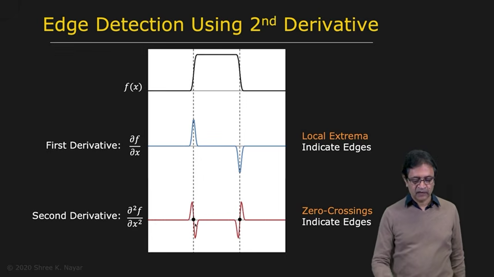
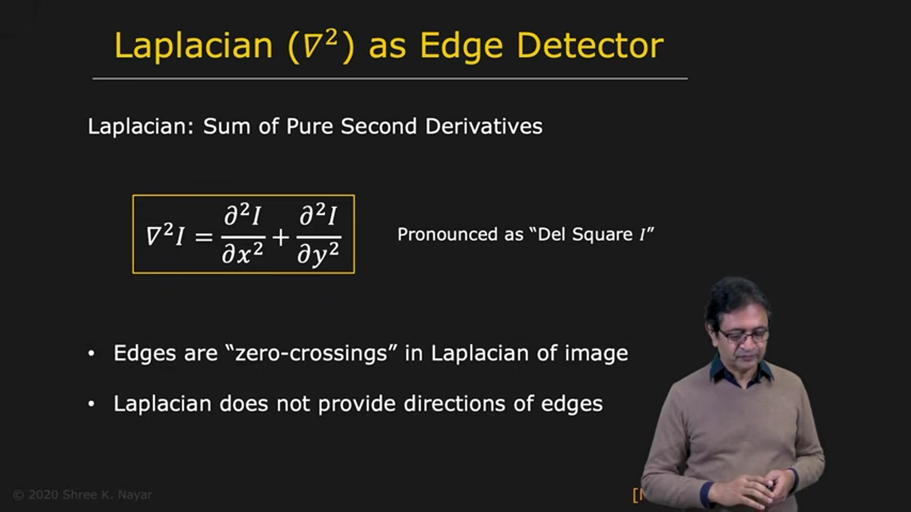
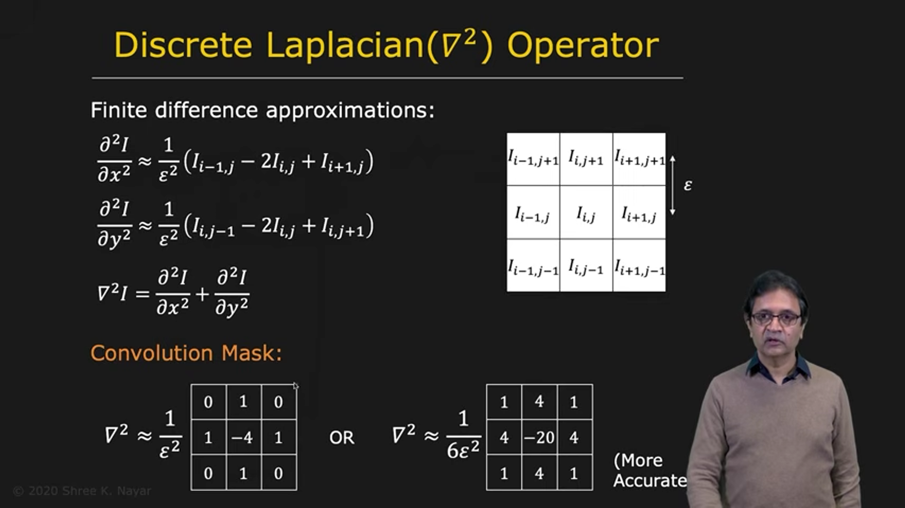
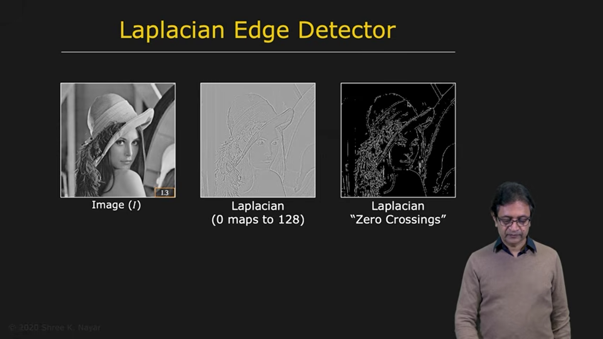
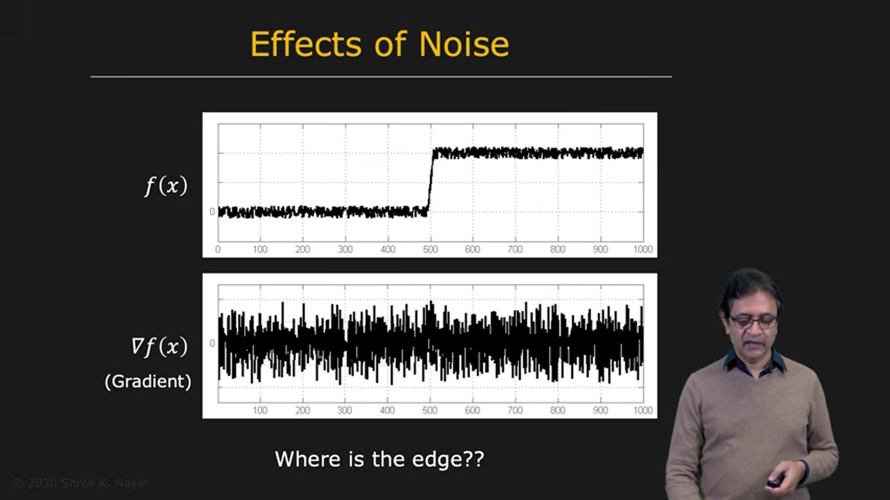
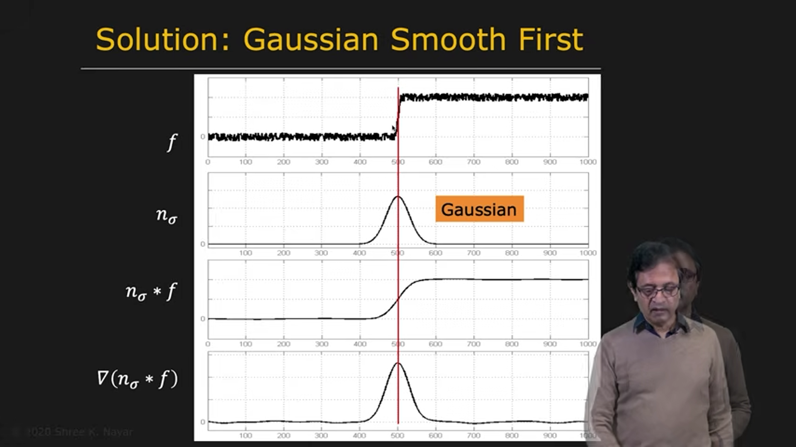
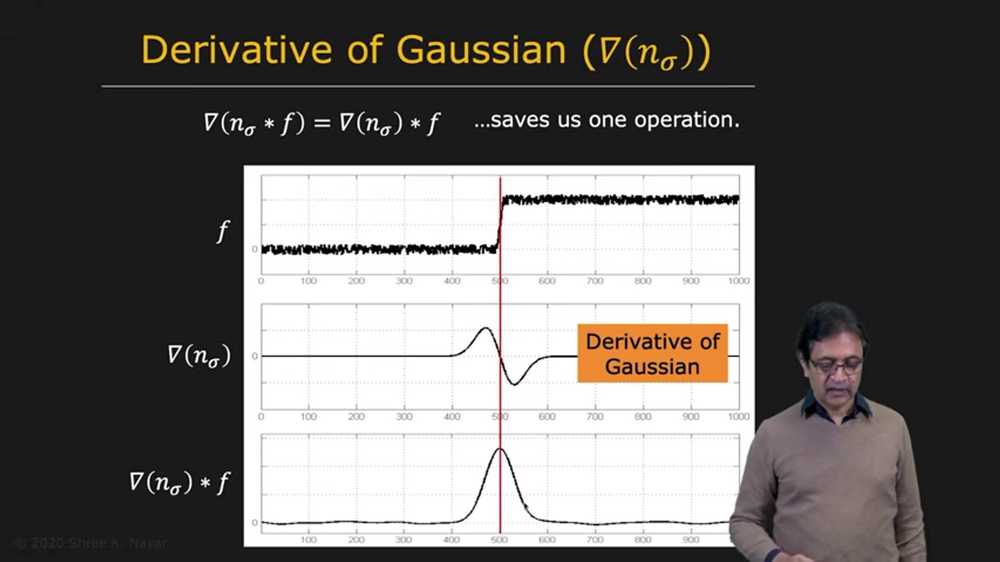
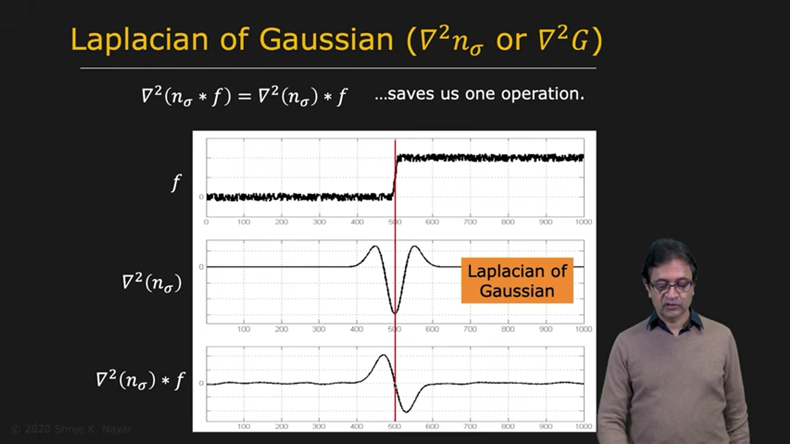

# Edge Detection Using the Laplacian

The Laplacian is an edge-detection operator based on the **second derivative** of an image. It detects edges by finding locations where the second derivative changes sign. These locations are called **zero-crossings**.

---

## 1. Understanding the Second Derivative in One Dimension

Consider a one-dimensional signal $f(x)$ containing a rising edge and a falling edge.

The first derivative is positive near the rising edge and negative near the falling edge. Away from the edges, the signal is approximately constant, so its derivative is close to zero.

The second derivative measures how the first derivative changes. Around an edge, it typically changes from positive to negative or from negative to positive. At the transition, the second derivative crosses zero.

This sign change is called a **zero-crossing**. A strong zero-crossing can indicate an edge location.

Unlike the first derivative, which produces a peak near an edge, the second derivative produces a sign change around the edge.

---

## 2. The Laplacian Operator

For a two-dimensional image $f(x,y)$, the Laplacian is the sum of the second derivatives in the horizontal and vertical directions:

$$
\nabla^2 f(x,y)
=
\frac{\partial^2 f}{\partial x^2}
+
\frac{\partial^2 f}{\partial y^2}
$$

Applying the Laplacian produces positive and negative responses around intensity changes. An edge can be located by detecting suitable zero-crossings in the Laplacian response.

The Laplacian does not directly provide the edge orientation. It gives an edge location through zero-crossings, but not the direction information available from the two components of the gradient.

---

## 3. Discrete Laplacian Using Finite Differences

A digital image is discrete, so derivatives must be approximated with finite differences. A second derivative is a difference of first differences and requires at least three samples along a direction.

Let $\epsilon$ be the spacing between adjacent pixels. The second derivatives can be approximated by:

$$
f_{xx}(x,y)\approx
\frac{f(x+\epsilon,y)-2f(x,y)+f(x-\epsilon,y)}{\epsilon^2}
$$

$$
f_{yy}(x,y)\approx
\frac{f(x,y+\epsilon)-2f(x,y)+f(x,y-\epsilon)}{\epsilon^2}
$$

Adding these approximations gives the four-neighbor Laplacian:

$$
\nabla^2 f(x,y)\approx
\frac{
 f(x+\epsilon,y)+f(x-\epsilon,y)
 +f(x,y+\epsilon)+f(x,y-\epsilon)-4f(x,y)
}{\epsilon^2}
$$

This corresponds to the convolution mask:

$$
K_4=\frac{1}{\epsilon^2}
\begin{bmatrix}
0 & 1 & 0\\
1 & -4 & 1\\
0 & 1 & 0
\end{bmatrix}
$$

The corner values are zero because this approximation uses only the horizontal and vertical neighbors of the center pixel.

or You can Remember like:

 

---

## 4. Including Diagonal Neighbors

The four-neighbor mask treats horizontal and vertical neighbors directly, but not diagonal neighbors. On a square pixel grid, the diagonal spacing is different from the horizontal and vertical spacing. A wider discrete approximation can include the diagonal pixels as well.

A common eight-neighbor Laplacian mask is:

$$
K_8=
\begin{bmatrix}
1 & 1 & 1\\
1 & -8 & 1\\
1 & 1 & 1
\end{bmatrix}
$$

The overall sign may be reversed depending on the convention used. The important features are the center coefficient and the surrounding neighbor coefficients, which together estimate the second-order intensity change.

This mask is commonly used as a discrete Laplacian operator. Its response can be scaled according to the pixel spacing and implementation requirements.

---

## 5. Interpreting the Laplacian Response

The Laplacian response can contain both positive and negative values. A display system that shows only nonnegative image intensities cannot represent these values directly.

For visualization, the response may be shifted so that zero is displayed as a middle-gray value. For example, in an 8-bit display, 128 may represent zero:

* values below 128 represent negative responses
* 128 represents zero
* values above 128 represent positive responses

A zero-crossing occurs where the response changes sign across neighboring pixels. Detecting strong zero-crossings produces an edge map.

---

## 6. The Effect of Noise

Noise is a serious problem for derivative-based edge detection.

Noise often changes rapidly from pixel to pixel. Derivatives also respond strongly to rapid changes, so even relatively weak noise can produce large derivative responses and obscure the true edge.

Therefore, it is often necessary to reduce noise before applying a gradient or Laplacian operator. A common approach is to smooth the image with a Gaussian filter.

---

## 7. Smooth Before Detecting Edges

Let $G_\sigma$ be a Gaussian filter with standard deviation $\sigma$. First smooth the noisy image:

$$
f_s=f*G_\sigma
$$

The smoothing reduces noise, although it also makes the edge less sharp. Applying an edge detector to $f_s$ can then produce a cleaner response.

The parameter $\sigma$ controls the amount of smoothing:

* a small $\sigma$ preserves fine details but removes less noise
* a large $\sigma$ removes more noise but may blur or eliminate small edges

This is a trade-off between noise suppression and edge localization.

---

## 8. Derivative of Gaussian

Because Gaussian smoothing and differentiation are linear operations, they can be combined into a single convolution.

For gradient-based detection:

$$
\frac{\partial}{\partial x}(f*G_\sigma)
=f*\frac{\partial G_\sigma}{\partial x}
$$

and similarly:

$$
\frac{\partial}{\partial y}(f*G_\sigma)
=f*\frac{\partial G_\sigma}{\partial y}
$$

Instead of smoothing the image and then differentiating it in two separate steps, convolve the image directly with the derivative of the Gaussian.

The derivative-of-Gaussian filters suppress some noise while measuring intensity change.

---

## 9. Laplacian of Gaussian

The same idea applies to the Laplacian. Smooth the image with a Gaussian, then apply the Laplacian:

$$
\nabla^2(f*G_\sigma)
=f*(\nabla^2G_\sigma)
$$

Thus, the image can be convolved directly with the **Laplacian of Gaussian (LoG)** filter:

$$
\operatorname{LoG}(x,y)=\nabla^2G_\sigma(x,y)
$$

The LoG filter has a central region of one sign surrounded by a region of the opposite sign. Its shape is often described as an inverted Mexican hat or sombrero.

Applying the LoG filter to an image produces a response whose zero-crossings can indicate edge locations.

---

## 10. Gradient and Laplacian Compared

| Property | Gradient | Laplacian |
|---|---|---|
| Derivative order | First derivative | Second derivative |
| Typical edge cue | Large gradient magnitude | Zero-crossing in the response |
| Edge location | Near a local maximum of gradient magnitude | At a sign change in the Laplacian response |
| Orientation information | Available from $f_x$ and $f_y$ | Not directly provided |
| Computation | Usually two derivative convolutions, then magnitude and direction | One Laplacian convolution, followed by zero-crossing detection |
| Noise sensitivity | Sensitive to noise; smoothing is often useful | Especially sensitive to rapid changes, including noise; smoothing is important |

Gradient-based detection typically requires a magnitude threshold to decide which responses are strong enough to count as edges.

Laplacian-based detection looks for zero-crossings. In practice, a minimum response or contrast change may also be used to reject weak zero-crossings caused by noise.

The two operators have complementary properties. The gradient provides strength and orientation, while the Laplacian provides edge locations through zero-crossings. Combining useful properties of both motivates more advanced methods such as the Canny edge detector.

---

## 11. Summary

The Laplacian is a second-derivative operator:

$$
\nabla^2 f=f_{xx}+f_{yy}
$$

Its main edge-detection idea is:

1. Smooth the image to reduce noise.
2. Apply the Laplacian, often by convolving with a Laplacian-of-Gaussian filter.
3. Find strong zero-crossings in the response.

The discrete Laplacian can be approximated using a small convolution mask. Unlike the gradient, the Laplacian does not directly provide edge orientation. Both methods are sensitive to noise, so smoothing is important. Their complementary strengths lead to more robust edge detectors such as Canny.
