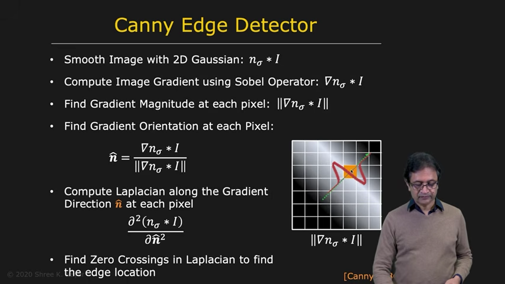
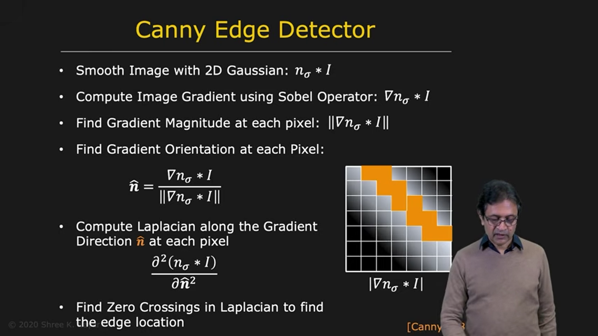
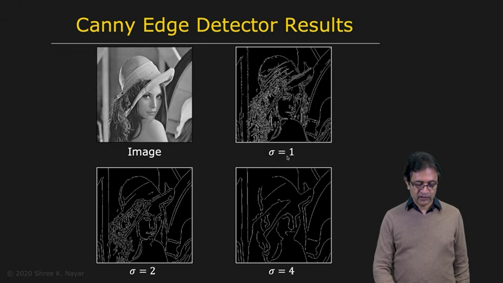

# The Canny Edge Detector

The Canny edge detector is one of the most widely used edge detectors in computer vision. It combines gradient-based edge strength and direction with second-derivative information to produce reliable, well-localized edges.

---

## 1. Main Idea

The Canny detector processes an image in stages:

1. Smooth the image to reduce noise.
2. Compute the image gradient.
3. Find the gradient magnitude and direction.
4. Examine intensity changes along the gradient direction.
5. Keep strong, well-localized edge responses.

The gradient supplies the edge strength and orientation. The second-derivative idea helps identify a sharp transition along the direction perpendicular to the edge.

---

## 2. Smooth the Image

Let $f(x,y)$ be the input image and $G_\sigma$ be a Gaussian filter with standard deviation $\sigma$. First, smooth the image:

$$
f_s(x,y)=f(x,y)*G_\sigma(x,y)
$$

Smoothing reduces noise, which is important because derivatives respond strongly to rapid intensity changes—including those caused by noise.

The parameter $\sigma$ controls the scale of the smoothing. Its effect is discussed below.

---

## 3. Compute the Gradient

Apply a gradient operator, such as the Sobel operator, to the smoothed image:

$$
f_x=\frac{\partial f_s}{\partial x},
\qquad
f_y=\frac{\partial f_s}{\partial y}
$$

At each pixel, the gradient magnitude is:

$$
M=\sqrt{f_x^2+f_y^2}
$$

The gradient direction is:

$$
\theta_g=\operatorname{atan2}(f_y,f_x)
$$

The gradient points in the direction of the fastest intensity increase. The edge runs approximately perpendicular to it. Let $\mathbf{n}$ denote the unit vector in the gradient direction; this is the direction across the edge.

A gradient-magnitude image can be visualized so that brighter pixels represent stronger intensity changes.

---

## 4. Locate Edges Along the Gradient Direction

Instead of applying the two-dimensional Laplacian equally in all directions, the Canny approach examines the image along the local gradient direction $\mathbf{n}$.

The second directional derivative is:

$$
D_{\mathbf{n}}^2 f_s
=
\mathbf{n}^{\mathsf T}
\left(\nabla^2 f_s\right)
\mathbf{n}
$$

where $\nabla^2 f_s$ in this expression denotes the Hessian matrix of second partial derivatives:

$$
\nabla^2 f_s=
\begin{bmatrix}
\frac{\partial^2 f_s}{\partial x^2} & \frac{\partial^2 f_s}{\partial x\partial y}\\[4pt]
\frac{\partial^2 f_s}{\partial y\partial x} & \frac{\partial^2 f_s}{\partial y^2}
\end{bmatrix}
$$

Intuitively, this measures how the image intensity changes when moving across the edge, rather than along it. A strong zero-crossing of this second directional derivative indicates a likely edge location.

This directional test avoids allowing unrelated changes in other directions to dominate the edge measurement.

> **Practical note:** Many standard Canny implementations describe this step as non-maximum suppression: retain a gradient-magnitude pixel only if it is a local maximum along the gradient direction. This thins broad gradient responses to approximately one-pixel-wide edges. The directional maximum test and the second-derivative zero-crossing express closely related ways of locating the center of an edge response.

---

## 5. Select Edges with Thresholds

After locating candidate edge responses, thresholding can reject weak responses. A common strategy is **hysteresis thresholding** with a low threshold $T_0$ and a high threshold $T_1$, where $T_0<T_1$:

* Responses above $T_1$ are strong edges.
* Responses below $T_0$ are rejected.
* Responses between the thresholds are retained only when connected to strong edges.

This allows weak parts of a continuous edge to remain while suppressing isolated weak responses caused by noise.

---

## 6. The Effect of the Smoothing Scale $\sigma$

Changing $\sigma$ changes which image structures are detected.

* **Small $\sigma$:** less smoothing; fine details and small edges remain, but more noise responses may appear.
* **Large $\sigma$:** more smoothing; noise and fine details are suppressed, leaving fewer, broader-scale edges.

This is related to **scale space**: image structures exist at different spatial resolutions. For example, a brick wall viewed close up may show both brick boundaries and tiny pores. Viewed from farther away, the pores disappear and the larger brick boundaries remain.

By changing $\sigma$, the detector can be tuned to the scale of edges relevant to an application.

---

## 7. Edge-Related Visual Illusions

The visual system does not always perceive geometric edges and lines exactly as they are. Context can change how parallel lines or angles appear.

### 7.1 Hering Illusion

In the Hering illusion, two horizontal lines appear to bulge outward and seem non-parallel when surrounded by radiating lines. When the surrounding lines are removed, the horizontal lines are revealed to be straight and parallel.

One explanation is that the acute angles in the pattern bias perception, making the horizontal lines appear curved. The precise reason for this perceptual effect is not fully understood.

### 7.2 Cafe Wall Illusion

In the Cafe Wall illusion, rows of black and white tiles make the horizontal mortar lines appear tilted relative to one another. When the tiles are removed, the lines are seen to be parallel.

The arrangement and contrast of the tiles influence how the visual system judges the positions and orientations of the lines. The exact perceptual mechanism is not fully understood.

These illusions demonstrate that human perception interprets edges in context; it does not simply report their physical geometry.

---

## 8. Summary

The Canny edge detector combines smoothing and gradient-based measurements to find reliable edge locations.

The main stages are:

1. Smooth the image with a Gaussian filter.
2. Compute the horizontal and vertical gradients.
3. Calculate the gradient magnitude and direction.
4. Locate thin edge responses along the gradient direction.
5. Use thresholding, commonly hysteresis, to reject weak or isolated responses.

The scale parameter $\sigma$ determines how much smoothing is applied and therefore which size of image structure is detected. Small scales preserve fine detail but are more sensitive to noise; larger scales produce fewer, coarser edges.

The Hering and Cafe Wall illusions further show that even human perception of lines and edges can be influenced by surrounding context.
